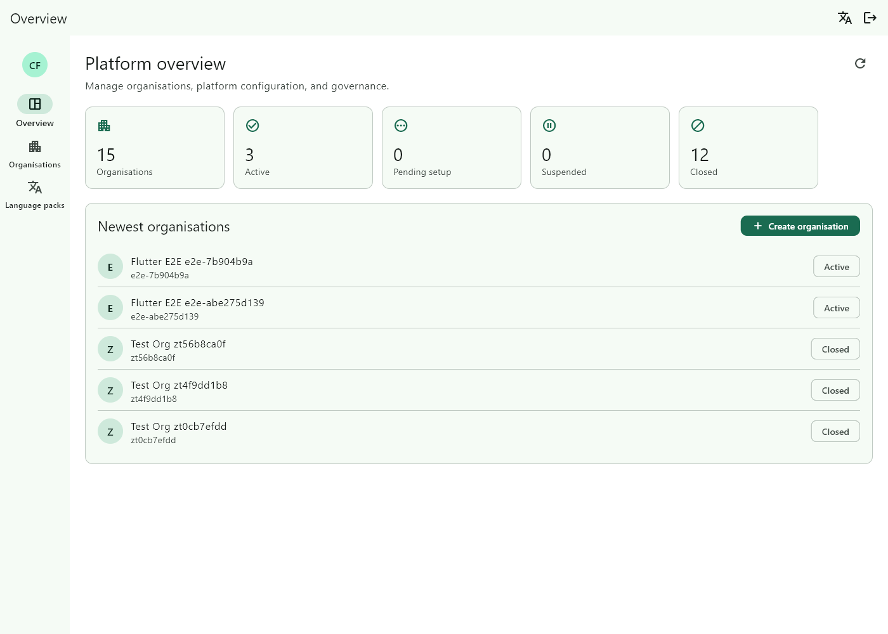
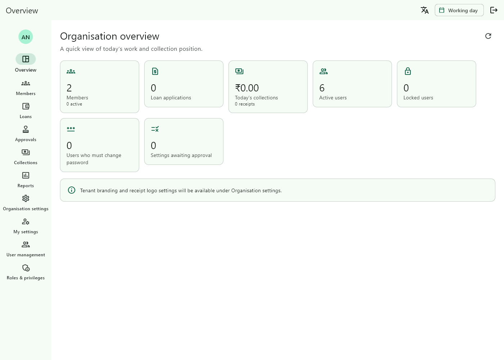
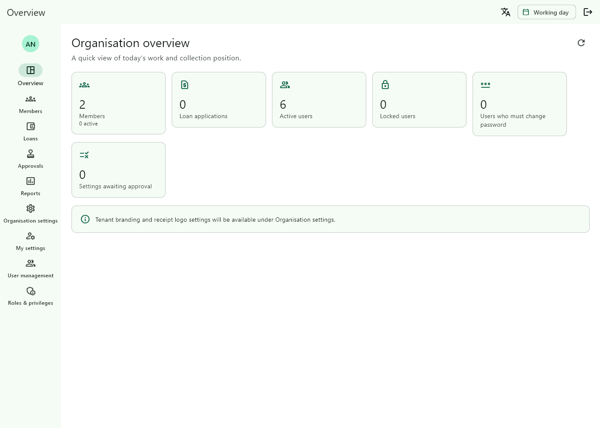
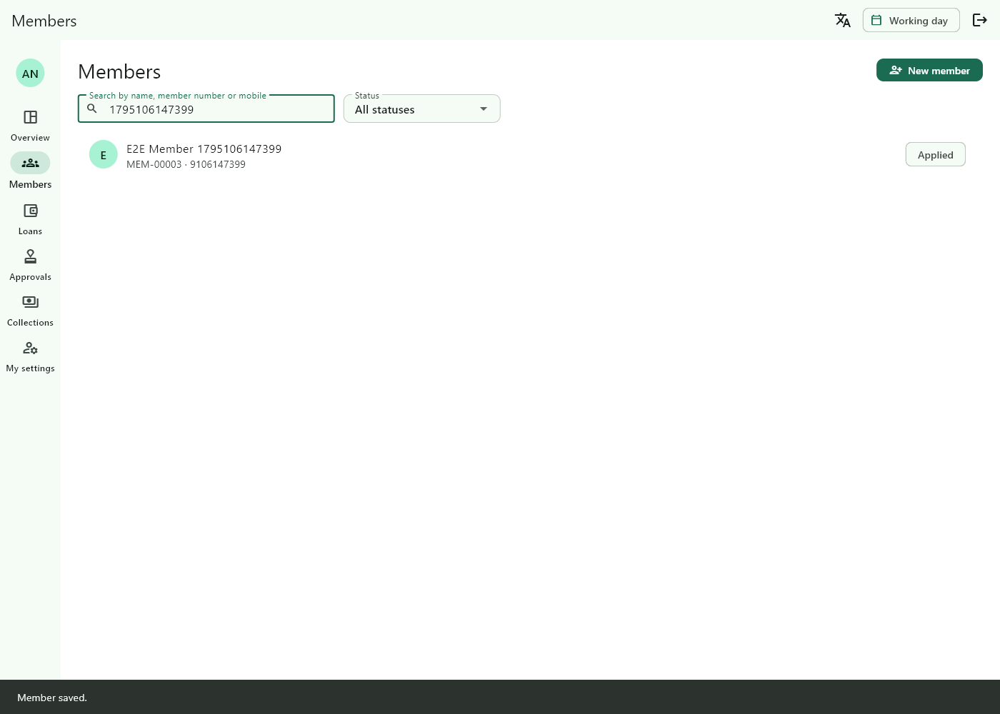

# Live Flutter E2E report

**Date:** 2026-11-19

**Environment:** Windows Flutter app against the locally configured API at `http://127.0.0.1:8000`

**E2E organisation:** `e2e-7b904b9a` (created through the Super Admin UI)

**Result:** PASS

## Validation results

| Run | Result |
|---|---:|
| `flutter analyze` | Passed; no issues found |
| `flutter test` | Passed; 58 tests |
| `integration_test/e2e_setup_test.dart` | Passed; created Org Admin and the EMP, MGR, ACC, LDR, and AUD users through Flutter UI; completed first-login password changes |
| `integration_test/live_e2e_test.dart` | Passed; 5 live scenarios |

The live scenarios verified the Super Admin dashboard, Org Admin overview, Super Admin module disable/restore and its effect on tenant menus, role-based navigation for all five staff roles, and an EMP user creating and finding a member. The EMP role correctly has no Reports menu under the seeded permission matrix. Collections was restored after the module test.

## Screenshots







Role navigation screenshots: [EMP](screenshots/role-EMP-navigation.png), [MGR](screenshots/role-MGR-navigation.png), [ACC](screenshots/role-ACC-navigation.png), [LDR](screenshots/role-LDR-navigation.png), [AUD](screenshots/role-AUD-navigation.png).



## Commands

```powershell
flutter analyze
flutter test
flutter test integration_test/e2e_setup_test.dart -d windows --dart-define-from-file=e2e_config.json
flutter test integration_test/live_e2e_test.dart -d windows --dart-define-from-file=e2e_config.json
```

Credentials remain in the ignored local `e2e_config.json`; they are not included in this report or screenshots.
