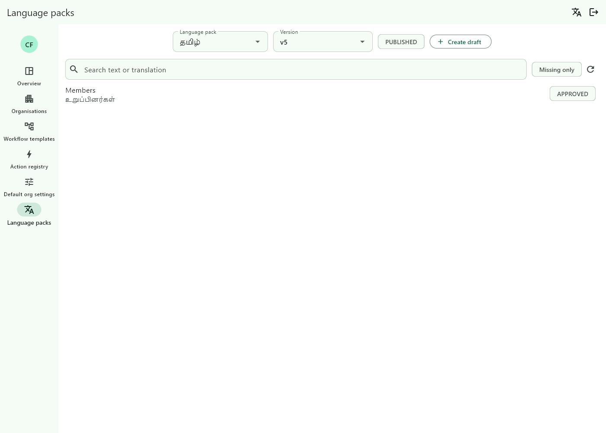

# Super Admin language pack CRUD test report

**Run date:** 2026-11-20

**Environment:** Flutter Windows app, local FastAPI at `http://127.0.0.1:8001`, local PostgreSQL database `nvs`

**Published Tamil language pack:** version 5

**Overall result:** PASS

## Test results

| Test layer | Cases | Result |
|---|---:|---|
| Full Flutter unit/widget suite (`flutter test --no-pub`) | 68 | PASS |
| Widget: action registry displays action and rule catalogues | 1 | PASS |
| Widget: default organisation page displays published setup defaults | 1 | PASS |
| Widget: language pack displays entries and supports load more | 1 | PASS |
| Mocked Windows integration: create draft, edit/approve entry, publish | 1 | PASS |
| Live Windows Flutter UI integration: create draft, edit/approve entry, publish against API and PostgreSQL | 1 | PASS |

The live flow logged in through Flutter, created a draft from the published Tamil pack, edited and approved the `nav_members` translation, then published the pack. The UI showed version 5 as `PUBLISHED` and the entry as `APPROVED`.

## Screenshot

## Local setup

- Added and applied `db/49g_seed_language_catalogue.sql` so the existing database has the real app label `Members` / `உறுப்பினர்கள்` in its translation catalogue.
- Flutter `.env` and ignored `e2e_config.json` point to port 8001.
- The local API is running on port 8001.
- Two empty draft packs (versions 1 and 2) from earlier failed live attempts remain in the local database; the live flow did not publish those. Version 5 is the published pack produced by the passing run.
